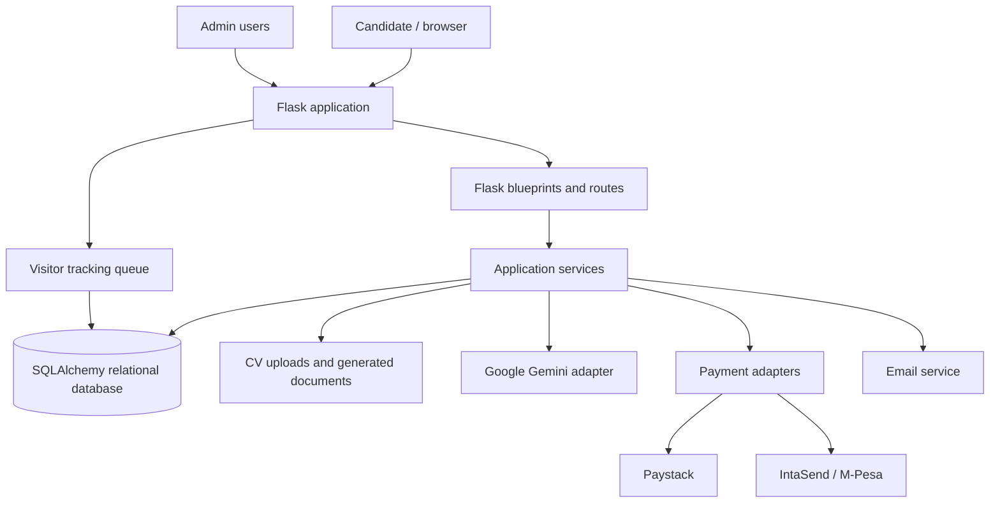

# CVForge — Sprint 004 Architecture, Security & Growth Audit

**Audit date:** 17 November 2026  
**Source reviewed:** `cvforge-sprint-003-admin-dashboard.zip`  
**Strategic milestone:** 10,000 registered users with sustainable revenue  
**Business direction:** Build from Africa, serve international customers from day one, bootstrap and reinvest revenue.  
**Audit type:** Static source review plus dependency-limited local validation. This is not a production penetration test or a live-database audit.

---

## 1. Executive decision

**Keep the existing Flask application and evolve it as a modular monolith. Do not rewrite it and do not split it into microservices yet.**

CVForge already has the core candidate workflow: accounts, CV creation, CV upload and AI revamp, ATS analysis, cover letters, templates, document exports, subscriptions, payment providers, public CV sharing, support and admin operations. Sprint 003 added onboarding, draft recovery, autosave, first-CV events and reminder emails. The current job-match record is a saved job-description comparison, not a job marketplace.

The highest-return next work is to make the existing system dependable and measurable:

1. Correct payment verification and subscription state handling.
2. Make plan entitlements match what the pricing UI promises.
3. Restore trustworthy funnel measurement and add the missing revenue/retention events.
4. Establish a real database migration and backup/recovery process.
5. Resolve privacy and retention gaps before increasing international traffic.
6. Build a private Career Workspace only after this reliability work is underway.

The employer marketplace should remain a later expansion, gated by employer interviews and pilot commitments.

## 2. Existing architecture and functionality

### 2.1 Current technical shape

The app factory in `app/__init__.py` wires extensions, security headers, blueprints, visitor tracking and CLI commands. The route layer is already divided by product area. Shared services handle AI, pricing, payments, document generation, upload validation, visitor tracking, email and conversion events.

### 2.2 Verified feature inventory

| Product area | Existing implementation | Audit status |
|---|---|---|
| Account access | Email/password, verification, password reset, Google OAuth, login throttling | Present; production email/OAuth checks still required |
| Onboarding | First-session onboarding and first-CV entry | Present |
| CV builder | Guided wizard, older builder, autosave, draft recovery, versions | Present |
| CV import | PDF/DOCX upload, content validation, parsing, fill-gaps flow | Present |
| AI writing | Section assistance, CV revamp, Career Coach, support chat | Present; provider/model smoke test outstanding |
| ATS | Saved-CV analysis, upload-and-check, job-description match | Present |
| Cover letters | Create, edit and export | Present |
| Templates | Gallery, seeded templates and admin controls | Present |
| Export | PDF and DOCX with plan gates and watermarked free preview | Present |
| Public CV | Tokenized, paid-plan-gated public sharing | Present; user privacy controls need review |
| Billing | KES plan catalog, Paystack checkout, IntaSend/M-Pesa, callbacks and claims | Present; financial-integrity gaps below |
| Administration | Users, plans, templates, payment claims, visitors, offers, broadcasts | Present |
| Growth reporting | `/admin/growth` and `/admin/conversion` | Present; event consistency and metric definitions need work |
| Retention | Upgrade nudges and abandoned-CV reminders | Present; email delivery and schedule are deployment-dependent |
| SEO/content | Sitemap, robots, canonical URL configuration, guides and CV examples | Present |
| Employer marketplace | No employer account, employer job posting or applicant workflow | Not implemented |
| Candidate workspace | No complete application tracker with stages, deadlines and notes | Not implemented |

### 2.3 Keep these working features

Do not replace the guided wizard, existing CV data model, upload parser, ATS service, template catalog, PDF/DOCX generators, payment provider adapters, public CV pages, admin operations or SEO routes as part of the next sprint. Refactor behind stable interfaces and preserve route behavior unless a verified defect requires a change.

## 3. Database and data-model assessment

### 3.1 Existing model inventory

The source defines 21 SQLAlchemy models:

- Identity: `User`, `Profile`, `UserSettings`
- CV and content: `Resume`, `ResumeVersion`, `CoverLetter`, `Template`
- Billing: `PricingPlan`, `Subscription`, `Payment`, `Offer`, `OfferRedemption`, `ManualPaymentClaim`
- AI and career analysis: `AIUsage`, `JobMatch`, `ATSReport`
- Operations and growth: `ActivityLog`, `Notification`, `PageVisit`, `Feedback`, `BroadcastEmail`

### 3.2 Strengths

- User-owned records generally have foreign keys and owner-scoped route queries.
- Email, username and Google identity are unique; profile/settings are one-to-one; public tokens and provider transaction IDs have uniqueness constraints.
- Payment and subscription records store the charged amount and currency, so historical amounts are not derived solely from the current displayed plan price.
- Resume sections are stored as JSON, which makes the builder flexible and supports many optional CV sections without a table per section.
- Timestamp handling has an explicit naive-UTC convention for SQLite and helper logic for comparisons.
- User deletion relationships cascade through several account-owned records, although there is no complete account-deletion workflow in the routes shown.

### 3.3 Gaps and risks

| Priority | Finding | Consequence | Required action |
|---|---|---|---|
| P0 | No committed `migrations/` directory is present in this archive; `.gitignore` previously excluded it | Schema changes cannot be reliably promoted or reviewed through this release package | Track migration scripts; create a baseline only after comparing it with the live schema |
| P1 | `Subscription.payment_reference` and `Payment.lipana_checkout_request_id` are indexed but not unique | Duplicate references or concurrent duplicate order handling are not prevented at the database layer | Add unique constraints after checking existing data; use a stable provider event/idempotency record |
| P1 | Subscription billing period is resolved from the current `PricingPlan` at payment confirmation | Editing a plan between checkout and webhook delivery can change the duration granted for an already-priced order | Snapshot plan slug, billing interval/duration, amount and currency when creating the order |
| P1 | Pricing is stored as `PricingPlan.price_kes`; there is no currency/region price book | International prices, localized display, taxes and price experiments are difficult to manage safely | Add immutable `PlanPrice` records by plan, currency, interval and market; preserve existing KES transactions unchanged |
| P1 | Payment provider raw payloads are stored in `Payment.raw_webhook` | Unnecessary personal/provider data may be retained indefinitely | Store minimal normalized event fields and a provider event reference; define retention |
| P2 | CV sections, ATS results and AI reports use JSON blobs | Flexible, but harder to query, validate and evolve consistently | Keep JSON for document content; add schema validation/versioning and normalize only query-heavy workflows |
| P2 | Several high-volume filters have no matching composite indexes (`ActivityLog.action`/`ip_address`, payment reference lookups) | Rate-limit, funnel and reconciliation queries become more expensive as volume grows | Add measured composite indexes during a migration, guided by production query plans |

### 3.4 Database and deployment decision

The deployment script is explicitly SQLite-oriented: it defaults to `instance/cvforge.db` and rejects a backup unless the file has a SQLite header. The dependencies also include PostgreSQL and MySQL drivers. The actual production database engine was not available for this audit.

**Before release, confirm the live database engine.** If production is SQLite, document its backup, WAL/journal and restore procedure and test concurrency limits. If production is PostgreSQL/MySQL, the current PythonAnywhere deploy backup path must be replaced with a provider-native snapshot or database-native backup; do not assume the SQLite file-copy backup is sufficient.

Keep SQLite for local tests and early development if useful. Plan a controlled PostgreSQL move before payment concurrency, analytics volume or marketplace operations make SQLite's locking and operational limits material.

## 4. Security and privacy assessment

### 4.1 Controls already present

- Passwords use Werkzeug password hashing.
- CSRF protection is enabled globally for browser forms.
- Admin routes use an explicit admin guard; impersonation is POST-only and audit logged.
- Session cookies are HttpOnly and SameSite Lax; Secure defaults to true.
- Responses add `X-Content-Type-Options`, `X-Frame-Options`, `Referrer-Policy` and a Permissions Policy; HSTS is enabled when secure cookies are configured.
- Login, registration, password-reset and verification-resend attempts have database-backed IP throttling.
- Uploads have extension, size, PDF magic-byte and DOCX OOXML checks; DOCX uncompressed size is capped.
- Resume and cover-letter routes generally scope lookups to `current_user.id`.
- Public CV links use random tokens and are gated by plan settings.
- The active checkout providers are Paystack and IntaSend. Paystack uses server-side transaction verification and amount/currency checks; IntaSend completion handling still needs equivalent amount/currency checks. Legacy Lipana-named fields and a dormant webhook handler remain in the codebase but are not configured checkout providers.

### 4.2 Release-blocking / high-priority findings

| Priority | Finding | Evidence in source | Action |
|---|---|---|---|
| P0 | The earlier founder audit reports that an older source/repository snapshot included `.env`, a local database and Git history, and that a Gemini key had previously appeared in history. This current ZIP does **not** contain `.env`, a database or `.git`, but it cannot prove the remote history is clean. | `FOUNDER_EXECUTION_AUDIT.md`; current archive contents | Rotate every credential ever exposed; inspect and clean remote history with a coordinated history rewrite if applicable; invalidate sessions after rotating `SECRET_KEY` |
| P1 | Non-Paystack payment success handling does not verify provider amount/currency against the pending order before activating a subscription. Paystack has a separate verification path that does check these values. | `app/routes/webhooks.py`, `_handle_payment_success` versus `confirm_paystack_payment` | Add provider-specific amount/currency/reference/customer validation before the shared activation function; reject missing payment rows and mismatched owner/order values |
| P1 | IntaSend uses a static webhook challenge echoed in each payload; on an unmatched completion the handler logs the entire payload. Other webhook paths also persist raw provider payloads. | `app/routes/webhooks.py`, `intasend_webhook`, `_handle_payment_success`, `_handle_payment_failed` | Never log the full payload or challenge; store only normalized safe fields; rotate the challenge if it has been logged; use a stronger provider signature if the provider supports it |
| P1 | `with_for_update()` is used for webhook idempotency, but it is ineffective on SQLite; references are not unique at the DB layer. | `app/routes/webhooks.py`; `Subscription` and `Payment` models | Use database uniqueness and idempotent event processing; test duplicate and concurrent delivery against the actual production DB engine |
| P1 | Authentication and several activity records store full `request.remote_addr`; visitor analytics separately stores a truncated IP. | `auth.py`, `cv.py`, `ats.py`, `support.py`, `feedback.py`, `admin.py`, `ActivityLog` | Update the privacy notice to distinguish security/rate-limit logs from page analytics; consider keyed IP hashing for rate limits and a defined retention window |
| P1 | Privacy policy says traffic data is automatically deleted after 90 days, but `prune-visits` is a manual CLI task and `visitor_tracking.py` explicitly says it is not scheduled automatically. | `privacy.html`, `visitor_tracking.py`, `cli.py` | Schedule and monitor the task in production or change the policy wording; add retention for activity, AI cache and webhook records |
| P1 | Terms say users can delete accounts from account settings, but the profile/settings routes in this snapshot do not implement account deletion. A self-service data export route is also not visible. | `terms.html`, `dashboard.py`, `dashboard/profile.html` | Implement a verified deletion/export workflow or correct the wording and provide a documented support process; handle payment-record retention separately |
| P1 | Public CV pages are intentionally accessible without login; contact details may be included in the published document. | `main.py`, `cv/public.html`, `cv.py` | Add a clear preview/consent step and field-level visibility controls before sharing; preserve the current opt-in token model |
| P2 | `ProxyFix` trusts one forwarded host/proto/IP hop globally. This is correct only when the app is behind the expected trusted proxy. | `app/__init__.py` | Restrict deployment to the trusted proxy topology; do not expose the WSGI app directly with spoofable forwarded headers |
| P2 | Content Security Policy is report-only and optional; there is no enforced CSP by default. | `config.py`, `app/__init__.py` | Collect browser reports in staging, then introduce a tested enforced policy without breaking checkout/OAuth/AI integrations |
| P2 | Upload checks validate structure but do not provide malware scanning. | `upload_validation.py`, `cv.py`, `ats.py` | Add malware scanning or a quarantine/processing boundary before scaling public uploads |
| P2 | Logout is a GET link, so it is not protected against cross-site logout requests. | `auth.py`, `base_dashboard.html` | Convert logout to POST with CSRF protection |

### 4.3 Privacy and international trust

The service stores CVs, contact details, job histories, AI outputs, support messages and payment references. Some of this data is sent to Gemini when a user requests AI processing. Before international acquisition, publish clear data-controller contact details, subprocessors, cross-border transfer information, retention periods, public-sharing controls and a practical data-rights process. Have the privacy and terms language reviewed for the markets CVForge actively serves; this audit is not legal advice.

## 5. Bugs and technical debt register

| Priority | Area | Defect / debt | Status |
|---|---|---|---|
| P1 | First-CV conversion | Registration events stored the raw browser session ID while `PageVisit` stored a hashed session ID. The landing-to-registration join therefore compared different identifiers and could report zero. | **Fixed in this working copy** by using one shared hashed-session helper for visitor and registration events; integration test added but not executable here without Flask dependencies |
| P1 | Payments | IntaSend activation path lacks the Paystack-equivalent amount/currency verification. | Open; implement with provider sandbox tests |
| P1 | Entitlements | `PricingPlan.daily_cv_limit`, `daily_cover_letter_limit` and `daily_ats_limit` are displayed/admin-editable but the route checks use a shared free-user limit or `is_premium`, rather than consistently enforcing the selected plan's configured values. | Open; centralize entitlement checks and add a matrix of plan tests |
| P1 | Entitlements | `User.is_premium` recognizes `pro`/`premium`, not `basic`; code comments acknowledge this. Any paid Basic plan must be explicitly distinguished from Pro-only benefits, and the admin home currently counts only Pro and Premium users. | Open; define one canonical plan/entitlement service and correct dashboard labels/counts |
| P1 | Subscription | The plan billing interval is read at webhook time, not frozen at checkout creation. | Open; snapshot immutable order terms |
| P1 | Database operations | No migration history is included in this source archive. Production migration history must be preserved separately from ordinary code deploys. | `.gitignore` and the PythonAnywhere deploy script now exclude migration directories; migration baseline remains open |
| P1 | Configuration | Blank values in `.env.example` could override defaults for `GEMINI_MODEL` and `GOOGLE_REDIRECT_URI`; `DATABASE_URL` had no local SQLite fallback despite README wording. | **Fixed in this working copy**; local instance directory is created by the app factory |
| P1 | Dependencies | IntaSend SDK was documented as a separate manual install and was absent from `requirements.txt`. | **Fixed in this working copy** by adding `intasend-python` to runtime requirements |
| P1 | Privacy | Policy/terms do not fully match the implemented account deletion, data export and retention controls. | Open; reconcile product and policy |
| P2 | Funnel | The first-CV report tracks a 30-day registered cohort; it does not measure email verification, checkout start/failure, renewal, cancellation, referral source or 30-day retention. | Open; add a stable event taxonomy |
| P2 | Funnel | `first_cv_downloaded` records that the server returned a generated file response; it cannot confirm the device saved or opened it. | Documented limitation; retain this event name/definition or add client confirmation separately |
| P2 | Funnel | The growth page uses same-window signup/payment ratios and a CV creation event; it is not a mature cohort/retention dashboard or contribution-margin report. | Open; add cohort windows and financial definitions |
| P2 | Email | PythonAnywhere free-tier SMTP limitations are documented; reminder delivery is dependent on a working provider and a scheduled task. | Open operational dependency; verify a transactional email API/provider before scaling |
| P2 | Internationalization | UI language preference exists but the main product copy and pricing catalog are not localized; price book and tax model remain KES-centric. | Open; design locale/currency abstractions before broad market expansion |
| P2 | Delivery | Deployment script uploads changed files and reloads, but does not install changed dependencies or run database migrations; deleted remote files are not removed. | Documented manual step; improve release orchestration and drift checks |
| P2 | Tests | Runtime dependency set is not locked to a tested version set; the local audit environment differs from CI (Python 3.13 here versus 3.12 in workflow). | Open; pin/lock dependencies and test the production Python version |

## 6. Customer journey and conversion assessment

### 6.1 Existing journey

1. **Discover:** homepage, pricing, free ATS checker, CV examples, guides and search traffic.
2. **Register:** email/password or Google OAuth.
3. **Verify:** email/password signups must verify before login; Google accounts are pre-verified.
4. **Onboard:** new users see a first-CV onboarding page with a guided-builder or upload choice.
5. **Reach first value:** build in the wizard, recover a draft, upload a CV, or run ATS analysis.
6. **Improve:** AI writing help, revamp, ATS feedback, templates and cover letters.
7. **Convert:** preview the real CV with watermark, then pay to download; payment options are Paystack and IntaSend/M-Pesa depending on configuration.
8. **Return/share:** dashboard drafts, email reminders, upgrade nudges and optional public CV sharing.

### 6.2 What is working in the journey

- Users can start creating before paying; the payment gate is at download rather than at login.
- The first-CV onboarding and draft recovery address the blank-page problem.
- Upload-and-improve gives users with an existing CV a faster route to value.
- The public CV page includes a “build your own” acquisition CTA.
- Admin conversion and growth pages provide an initial internal measurement surface.

### 6.3 Main friction and missing evidence

- Email verification introduces an additional step; no explicit `email_verified` funnel event is recorded in the visible event taxonomy.
- There is no reliable view of registration-start → registration-complete → verification → first meaningful action → checkout-start → payment-success/failure.
- The landing-to-registration metric had the session hash mismatch described above; the code has been corrected in this working copy, but the integration test still needs to run in CI/staging.
- A CV being created is not necessarily a completed or useful CV. Keep `cv_create` as a basic activation proxy, but define a stronger activated-user metric such as first CV completed or a successful ATS check.
- `first_cv_downloaded` is a paid-gated server response, not a verified local save; interpret it as “download response served.”
- Visitor tracking is asynchronous and intentionally drops events if the queue fills; events still in memory can be lost on process restart. Do not use it as financial or exact billing evidence.
- The growth dashboard reports registrations, CV creation, successful payments and revenue by currency, but lacks mature cohorts, retention, churn, acquisition source, CAC and contribution margin.
- Current checkout and plan prices are KES-based. Card acceptance does not by itself constitute localized international billing.

### 6.4 Recommended event taxonomy

Use one shared event service and stable event names/properties. Keep personally identifying CV text out of analytics properties.

| Stage | Events to record |
|---|---|
| Acquisition | `landing_view`, `pricing_view`, `free_ats_completed`, `cv_example_view`, `signup_started` |
| Account | `registration_completed`, `email_verified`, `login_completed` |
| Activation | `onboarding_completed`, `cv_started`, `cv_completed`, `ats_check_completed`, `cover_letter_created` |
| Monetization | `checkout_started`, `payment_succeeded`, `payment_failed`, `download_response_served`, `subscription_expired` |
| Retention | `return_visit_7d`, `return_visit_30d`, `cv_updated`, `application_saved`, `subscription_renewed`, `subscription_cancelled` |
| Referral | `public_cv_shared`, `referral_visit`, `referral_registration` |

Capture consent-aware source/UTM, country (coarse, where lawful), device class and product version. Define event idempotency and retention before adding more dashboard queries.

## 7. Revised product and technical architecture

### 7.1 Product layers — preserve existing features

**Layer A — Candidate core (existing):** account/profile, CV builder, upload/parser, AI writing, ATS, cover letters, templates, exports and public CV.

**Layer B — Career Workspace (next):** saved job opportunities, application stages, deadlines, notes, follow-up reminders, interview preparation and links to the CV version used for each application. This is a private candidate tool first; it does not require a public job marketplace.

**Layer C — Employer pilot (later):** verified employer profile, job posting, applicant list, candidate review and status updates. Build only after employer interviews and several committed pilot employers.

**Layer D — Global infrastructure (progressive):** localized price books, currency-aware checkout, provider routing, country/locale formatting, privacy/retention controls and region-aware support. Avoid hard-coding country assumptions into the CV domain model.

### 7.2 Technical boundaries

Keep a single Flask deployment for now, with clearer domain boundaries:

- `identity`: registration, verification, OAuth, profile and preferences.
- `documents`: CVs, versions, templates, parsing, export and sharing.
- `career`: ATS, job matches and the future application tracker.
- `ai`: Gemini adapter, prompts, usage, caching and safety validation.
- `commerce`: plan catalog, immutable price/order snapshots, subscriptions and entitlements.
- `payments`: provider adapters, normalized webhook events, reconciliation and refunds.
- `growth`: event definitions, attribution, cohort queries and admin reporting.
- `communications`: transactional email, reminders, support and notifications.

Routes should validate input and call domain services. Provider-specific details should stay inside adapters. The database remains the source of truth for users, CVs, orders and subscriptions. Background tasks can begin as explicit scheduled CLI commands; introduce a durable queue only when delivery volume/retry requirements justify it.

### 7.3 Architecture decision

- **Do not** rewrite Flask, replace SQLAlchemy, or introduce microservices now.
- **Do** introduce a centralized entitlement service and a normalized payment event handler.
- **Do** create tracked migrations and automated staging checks.
- **Do** keep the existing CV JSON structure for now, adding validation/version metadata before normalizing sections.
- **Do** move to PostgreSQL when production concurrency/operations require it, with a tested migration plan rather than an in-place assumption.

## 8. Prioritized implementation plan

### Sprint 004 — audit, reliability and measurement (current)

Deliverables:

- Architecture/functionality inventory and revised modular-monolith design.
- Database/security assessment and prioritized bug/technical-debt register.
- Customer journey and conversion assessment.
- Fix the registration/landing session identifier mismatch.
- Fix blank environment-value fallbacks and local SQLite default.
- Ensure migrations can be committed and include IntaSend in runtime dependencies.
- Define staging release gates and the next implementation sequence.

### Sprint 005 — payment and entitlement integrity

1. Normalize all payment provider payloads into one internal event shape.
2. Verify amount, currency, reference, order, user and provider transaction ID for every provider.
3. Add unique references and idempotent event handling; test duplicate, replayed, invalid and concurrent webhooks.
4. Snapshot plan, amount, currency and billing interval at checkout creation.
5. Implement a central entitlement resolver using the actual active plan and its configured limits/features.
6. Correct admin paid-subscriber totals and labels for Basic/Pro/Premium.
7. Add sandbox reconciliation and refund/manual-claim audit tests.

### Sprint 006 — funnel and retention measurement

1. Add the event taxonomy above, including email verification and checkout events.
2. Correctly join anonymous acquisition sessions to registration without exposing raw session IDs.
3. Add 7/30/90-day signup cohorts, activation, paid conversion, repeat use and churn views.
4. Add UTM/referral attribution and consent/retention rules.
5. Add contribution-margin reporting: gross receipts less provider fees, AI variable cost, refunds and variable support costs.
6. Verify reminder email delivery, suppression rules and scheduled execution.

### Sprint 007 — Career Workspace MVP

1. Saved opportunity records owned by the candidate.
2. Application status, deadline, notes and status history.
3. Attach a selected CV version and cover letter to an application.
4. Reminder preferences and due-date notifications.
5. Closed beta with candidate interviews; measure weekly active use and repeat visits.

### Later — international billing and employer pilot

- Add multi-currency price books and localized checkout only after provider/country support is verified.
- Interview at least 10 employers/institutions and validate job supply before building employer tooling.
- Pilot a small employer workflow with verified companies before a public marketplace launch.

## 9. First major growth milestone

The agreed milestone is **10,000 registered users with sustainable revenue**, not registrations alone.

Use the following initial scorecard as targets to validate, not forecasts:

| Metric | Initial target | Definition |
|---|---:|---|
| Registered users | 10,000 | Unique verified accounts; also report total accounts separately |
| Activated users | 3,000 | Users who complete a first CV or another defined meaningful career task |
| Paying customers | 500 | Unique customers with at least one successful paid transaction |
| 30-day return rate | ≥30% | Share of newly activated users with a meaningful return action within 30 days |
| Contribution margin | Positive | Revenue less provider fees, AI variable cost, refunds and variable support costs |
| Acquisition | Repeatable | At least one channel with measured CAC and conversion by cohort |

Do not begin scaling paid acquisition simply because signups rise. Scale only when activation, payment reliability, retention and contribution margin are observable.

## 10. Validation results and limitations

### Executed in this working copy

- `python -m compileall -q app tests config.py` — passed.
- Focused dependency-light tests — **16 passed** (`test_config_defaults.py`, `test_cv_diff.py`, `test_seo_keywords.py`).
- A broader partial selection produced **48 passed, 6 skipped and 3 failures caused by missing Flask imports** in tests that load the full application stack.
- Full `python -m pytest -q` cannot collect all tests in this environment because Flask and Werkzeug are not installed. The Sprint 003 integration test is therefore not executed here.

### Not verified

- Live database schema, data volume, production DB engine and backup restoration.
- Production secrets, remote Git history, deployment environment and scheduled tasks.
- Live Gemini model availability, OAuth credentials, SMTP/API email delivery and payment provider credentials.
- Browser-level mobile usability, performance under load and production conversion baselines.
- Provider sandbox webhooks, concurrent event delivery and refunds.

**Release gate:** run the complete test suite in the repository's Python 3.12 CI/staging environment, then exercise registration, verification, CV creation, autosave/resume, AI flows, ATS, paid download, all provider webhooks, duplicate events and reminder opt-outs against a staging database before production deployment.
